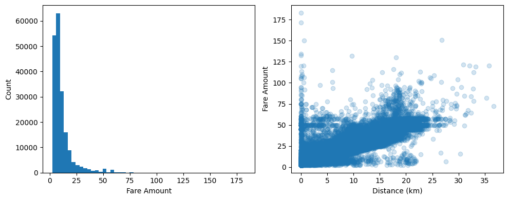
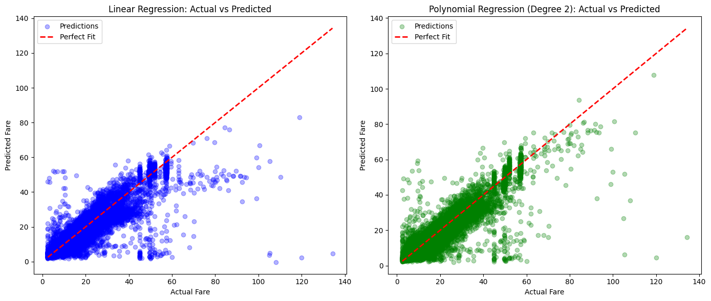
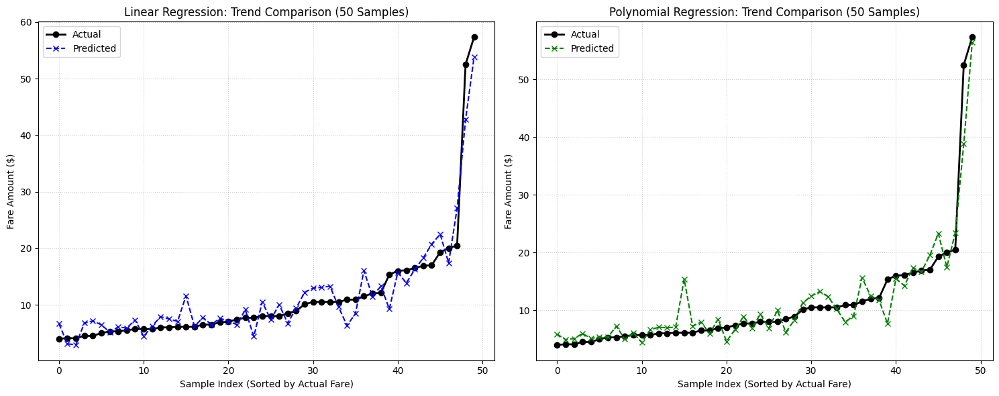

# Uber Fare Prediction

A machine learning project that predicts the cost of an Uber ride from trip details.

## Overview

The project reads 200,000 taxi trips from `uber.csv`, cleans the data, adds new features, and trains two regression models to predict `fare_amount`. Model quality is measured with R2 and RMSE.

## Files in this project

| File | Description |
| --- | --- |
| `uber.csv` | Trip data with 200,000 rows |
| `uber_fare_prediction.ipynb` | Full notebook with code and results |
| `images/` | Charts saved from the notebook |

## Data columns

| Column | Description |
| --- | --- |
| `key` | Unique trip ID, removed before training |
| `fare_amount` | Fare in USD, this is the value we predict |
| `pickup_datetime` | Date and time when the trip started |
| `passenger_count` | Number of passengers |
| `pickup_longitude` and `pickup_latitude` | Trip start location |
| `dropoff_longitude` and `dropoff_latitude` | Trip end location |

The CSV also contains an extra `Unnamed: 0` column. It is an old index and is removed before training.

## Method

| Step | What was done |
| --- | --- |
| 1 | Reviewed the rows, column types, summary values, and missing values. One row was missing dropoff location data. |
| 2 | Removed `Unnamed: 0` and `key`, dropped missing rows, and kept sensible values. Longitude is from -74.3 to -73.7, latitude is from 40.5 to 41.0, passenger count is from 1 to 6, and fare is from $2.5 to $200. |
| 3 | Added `distance_km` from the pickup and dropoff points. Split `pickup_datetime` into `hour`, `day`, `month`, `year`, and `day_of_week`. Removed zero distance trips and the original date column. |
| 4 | Plotted the fare distribution and distance against fare. Distance had the strongest link to fare, with a correlation of 0.88. |
| 5 | Split the data into 80 percent for training and 20 percent for testing, with random state 42. |
| 6 | Trained Linear Regression and Polynomial Regression with degree 2. |
| 7 | Compared both models on the test data. |

## Results

| Model | R2 Score | RMSE |
| --- | --- | --- |
| Linear Regression | 0.8016 | 4.2326 |
| Polynomial Regression degree 2 | 0.8380 | 3.8248 |

Polynomial Regression performed better. It explains about 84 percent of the change in fare and has an average error of about $3.82. A higher R2 score and a lower RMSE are better.

## Charts from the notebook

### Fare distribution and distance

### Actual fare and predicted fare

### Actual fare and predicted fare on 50 sample trips

## How to use the notebook

Open `uber_fare_prediction.ipynb` in Jupyter or Google Colab and run the cells in order. The notebook reads the data from a hosted copy of `uber.csv`. A local copy is also included in this project.

## Tools used

Python, pandas, NumPy, Matplotlib, and scikit-learn.
